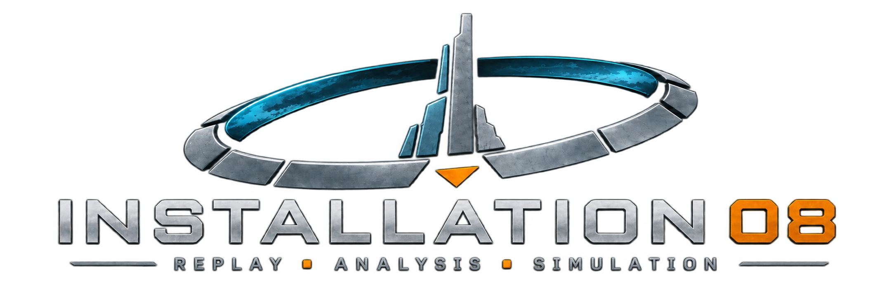

<h1 align="center">
  
</h1>

Rewatch your Halo Infinite matches in full 3D, on your own PC.

Pick a recent match, and Installation 08 rebuilds it: the real map from your installed game,
every Spartan in their own armor and coatings, their weapons, grenades and equipment, the kill
feed, the HUD, and the match's sounds. Then you can watch it from anyone's eyes, over their
shoulder, or from a free camera anywhere on the map, and export the moment to a video.

By Jordan Hewitt ([llampwall](https://github.com/llampwall)), built on JGtm's
[LevelUp](https://github.com/JGtm/LevelUp). See [Credits](#credits).

## What you can do

- **Watch any player's match** in first person, third person, or a free camera, at 0.5x to 4x
  speed or frame by frame.
- **Jump to the action**: kills, deaths and medals are marked on the timeline, and you can
  step from one event to the next.
- **See it the way it looked**: the game's own maps, lighting, armor, weapon coatings and
  first-person arms, all read from your installed copy of Halo Infinite.
- **Look up other players**: search any gamertag and fetch their recent matches.
- **Export a clip** of any stretch of a match to a video file.
- **Switch to a 2D map view** to follow the whole match from above.

Everything runs locally. The app reads only Halo's own data: your installed game files and
match records from the Xbox services. It has no account of its own and nothing is uploaded
anywhere.

## Getting started

### What you need

- Windows 10 or 11 (64-bit).
- Halo Infinite installed through Steam or the Xbox app. The app finds either install on any
  drive. If yours lives somewhere unusual, set `LEVELUP_HALO_DEPLOY` to its `deploy` folder.
- A capable GPU: it is developed on an RTX 4080 with 64 GB of RAM. On a weaker card, use
  Standard textures rather than High.
- Disk space: each map you watch is built once per texture quality, at roughly 600 MB to
  1.5 GB per map per quality.

### Run it

1. Download the release zip, unzip it anywhere, and double-click `installation-08.exe`.
   It starts a small local server and opens the viewer in its own window.

   The app is not code-signed, so the first time Windows shows **"Windows protected your PC"**.
   Click **More info**, then **Run anyway**. That is the normal prompt for unsigned software.
   (If Windows instead says it found a threat and removed the file, that is a different problem:
   please report it rather than work around it.)

2. **Sign in** from the home screen. You get a short code and a Microsoft link; open the link,
   sign in with your Xbox account, and enter the code. The app never sees your password, and
   it stores its sign-in encrypted for your Windows user only.

3. **Pick a match** under Recent matches and click **Fetch**. The app downloads that match's
   film and stats.

4. **Watch.** The first time you open a match on a map, the app builds that map from your game
   files, once per texture quality. This takes a few minutes per map (longer at High); after
   that it opens right away.

On the very first start the app also prepares, in the background, the things every match
shares: weapons, armor, first-person arms, coatings and the announcer. The home screen's
**Getting ready** panel shows their progress. You can sign in and fetch matches meanwhile.

Your matches and builds live in `%LOCALAPPDATA%\infinite-theater-3d\data`.

The app tells you when a new release is out. To report a bug, use **Help > Report an issue**
in the app's menu.

### Checking a download

Each release comes with a `SHA256SUMS` file. To confirm your zip is the one that was published,
hash it and compare the result with its line in that file:

```powershell
Get-FileHash .\installation-08-<version>-windows-amd64.zip -Algorithm SHA256
```

## Watching a replay

The player has a control bar and a timeline at the bottom; the keyboard covers the rest.

| Key | Does |
|---|---|
| Space or K | Play / pause |
| Left / Right, or J / L | Back / forward 10 seconds |
| `,` / `.` | Previous / next frame |
| `[` / `]` | Previous / next kill, death or medal of the selected player |
| 1 / 2 / 3 | First person / third person / free camera |
| V | Switch between the 3D view and the top-down view |
| Tab (hold) | Scoreboard |
| M | Sound on / off |
| R | Restart |
| F | Fullscreen |

Choose whose view you watch with the player menu at the bottom left. **Textures** on the match
library page picks Standard or High map textures: High looks sharper, but its first build of
each map takes longer and uses more space.

See [docs/KNOWN-ISSUES.md](docs/KNOWN-ISSUES.md) for what is still rough in this release, and
[docs/CHANGELOG.md](docs/CHANGELOG.md) for what changed.

## Build from source

You need:

- [Go](https://go.dev/dl/) 1.26.11 or newer.
- A 64-bit MinGW-w64 C compiler (`gcc`) on `PATH`; for example
  [WinLibs](https://winlibs.com/), or `winget install BrechtSanders.WinLibs.POSIX.UCRT`. The
  build needs cgo for the game's texture decompression and texture compression.
- [Node.js](https://nodejs.org/) 22 or newer, with npm.
- PowerShell 7.

Then, from the source folder:

```powershell
cd web
npm ci
cd ..
tools\package.ps1 -Version my-build
```

The result is in `dist\`: the same single `installation-08.exe` the release ships (with the
viewer built in), its folder and a zip. Run it exactly like the downloaded release. The first
compile takes a few minutes. Your build won't be byte-for-byte identical to the published
release, because the version name is baked in.

## Going deeper

- [docs/REFERENCE.md](docs/REFERENCE.md): the command line, the one-time builds, the local
  server's options and routes, where data lives, and how sounds and coatings are extracted.
- [docs/PARITY.md](docs/PARITY.md): what the viewer covers compared with the game.
- [docs/TODO.md](docs/TODO.md): the engineering backlog.

## Credits

- **[JGtm](https://github.com/JGtm)**: [LevelUp](https://github.com/JGtm/LevelUp) and its
  published modules this project vendors and builds on:
  [halo-infinite-film-decoder](https://github.com/JGtm/halo-infinite-film-decoder),
  [halo-infinite-map-images](https://github.com/JGtm/halo-infinite-map-images), and
  [halo-infinite-files-reader](https://github.com/JGtm/halo-infinite-files-reader)
  (GPL-3.0-only as a whole, with its vendored `ooz` decompressor; the others are AGPL-3.0), plus
  [halo-api](https://github.com/JGtm/halo-api) (used directly as a Go module, not vendored).
  The replay sound set was hand-produced by LevelUp. See
  [third_party/README.md](third_party/README.md) for versions and the changes made here.
- **[TheHaloArchive](https://github.com/TheHaloArchive)**: [ekur](https://github.com/TheHaloArchive/ekur)
  (Copyright (c) 2026 The Halo Archive, GPL-3.0-or-later), the coating reference for armor,
  weapon and first-person coatings: `internal/ekurport` translates parts of Ekur 1.3.1 to
  build the export straight from the game (the ported files keep Ekur's copyright line) and
  follows the tag reading approach of infinite-rs 0.13.2 (Surasia, Unlicense OR MIT).
  GPL-3.0-or-later can be combined with this project's AGPL-3.0.
- **[Den Delimarsky](https://github.com/dend)**: [OpenSpartan](https://github.com/OpenSpartan)'s
  libfilmshell (MIT), the Rust decoder of the match film format whose vocabulary the vendored
  `film-decoder` maps to (`third_party/film-decoder/GLOSSARY.md`). No libfilmshell code is
  included.
- **[Gravemind2401](https://github.com/Gravemind2401)**: [Reclaimer](https://github.com/Gravemind2401/Reclaimer)
  (GPL-3.0): several tag layouts and rules in the vendored `map-images` module were first
  read from Reclaimer's sources, then independently re-measured on game files and
  reimplemented in Go. No Reclaimer code is included; see
  `third_party/map-images/NOTICE.md`.
- **[Andy Curtis](https://github.com/acurtis166)**: [SPNKr](https://github.com/acurtis166/SPNKr),
  the Python SDK for the Halo Infinite web API, whose reading of the match highlight and medal
  events the film decoder builds on. No SPNKr code is included.
- **[hcs](https://github.com/hcs64)**: [ww2ogg](https://github.com/hcs64/ww2ogg): the basis
  for `internal/wwvorbis`'s Go port that repacks the game's Wwise Vorbis voice lines to Ogg.

## License

AGPL-3.0. See [LICENSE](LICENSE), [NOTICE.md](NOTICE.md) and
[third_party/README.md](third_party/README.md).
